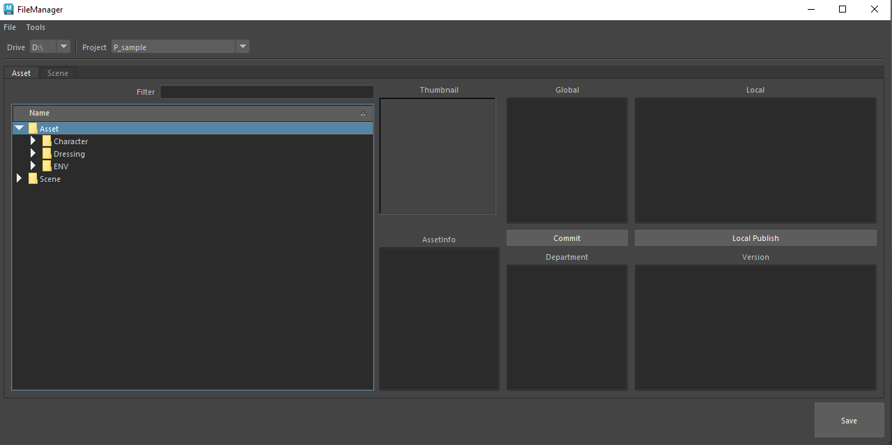
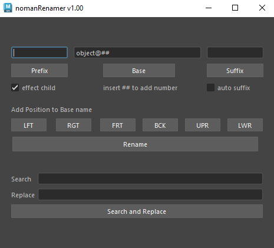

# nmTools 🛠️
### Production-Ready Maya Procedural Rigging & Pipeline Framework


**nmTools** is a professional, modular auto-rigging framework and pipeline toolset developed for Autodesk Maya. Built from production experience across feature film and game development, it empowers technical artists and character setup TDs to construct stable, cycle-free, and game-engine-ready rigs with high procedural control.

---

## 🌟 Core Architecture & Key Capabilities

### 🦴 1. Modular Procedural Auto-Rig Framework (`function/rigging/autoRig/`)
* **Limb & Spine Systems (`components/limbRig/`, `eh_armRig.py`, `eh_bipedLegRig.py`)**:
  * **Pure Double IK Quadruped Architecture (`eh_quadrupedLegRig_DoubleIK.py`)**: A modern 3-chain setup (`ikRPsolver` upper + `ikSCsolver` lower + 2-bone guide) that mathematically resolves Maya's native `ikSpringSolver` world rotation planar twist/flipping flaw.
  * **FK/IK Dual Chains**: Seamless IK/FK switching, auto-stretch with volume preservation, Soft IK, Knee Lock, and Elbow Lock.
  * **Procedural Finger & Add-Rigs (`components/fingerRig/`)**: Omni-curl setups, attribute-driven spread, and SDK automation.
* **Dynamic Tail & Spline Systems (`addRig/eh_creatingDynamicIkSpineRig.py`, `snake_AutoRig.py`)**:
  * Matrix-driven dynamic spline IK with Local/World orient switching and automated slide hierarchies.
* **Corrective & Helper Joint Networks (`corrective/eh_weightedHelperJnt.py`)**:
  * Matrix-based single-weight parent/driver helper joints with dynamic restraint space and corrective bulge push.
  * Integrated **Signed Swing-Angle Reader (`connection/eh_rotationReader.py`)** using `angleBetween` and rest vector projections for degree-accurate corrective pushes without gimbal locking.

### 📐 2. Mathematical Matrix-Based Rigging Engine (`function/rigging/constraint/`, `base/core.py`)
* **Clean Bake-Safe TRS Evaluation**: Avoids `offsetParentMatrix` animation baking flaws. Decomposes transformation matrices directly into standard `translate`/`rotate`/`scale` channels with Quaternion `jointOrient` compensation, ensuring 100% clean baking and export compatibility for Unreal Engine and Unity.
* **Dynamic Multi-Space Switcher (`spaceSwitch.py`)**: $N$-target matrix parenting with enum-driven Channel Box switching and zero rest-pose drift.
* **Mesh Surface Riveting (`rivetWithAddMatrix.py`)**: Fast matrix-based surface attachments with decomposed TRS and `pickMatrix` channel filtering.

### 🎗️ 3. Matrix Spline Ribbon Systems (`components/ribbonRig/`)
* Procedural NURBS ribbon setups driven by matrix offsets and micro-twist distribution for organic bending on limbs, tentacles, and brows.

### 📋 4. Centralized Production Pipeline Menu (`nmMenu`)
* **`nmMenu2023.py`**: A unified Maya main menu bar organizing studio workflows by department:
  * **Rigging**: Instant controller shape generators, Zero/Gimbal group creators, joint orientation helpers, and curve joint generators.
  * **Skinning**: Weight import/export utilities, recursive weight copying, and weight rounding tools.
  * **Modeling & Renamer**: Batch renaming, prefix/suffix handling, and hierarchy cleaners.

### 📂 5. Multi-DCC File & Asset Management (`function/pipeline/file_manager/`)
* Cross-application asset and scene version manager supporting **Maya**, **Blender**, and **Standalone Python (PySide2)**.
* Automated project directory routing, version increments, and thumbnail generation.

---

## 📸 Previews

| File Manager | Renamer Tool |
| :---: | :---: |
|  |  |

---

## 📚 Technical Documentation & Knowledge Base

* 📖 **[Naming Conventions](naming_convention.md)**: Standardized node prefixes, suffixes, and side tokens (`LFT`, `RGT`, `CEN`) for deterministic pipeline scripting.
* 🛠️ **[Technical Issues & Solver Gotchas](TECHNICAL_ISSUES.md)**: In-depth engineering case studies documenting mathematical anomalies in Maya solvers (e.g., `ikSpringSolver` world rotation twist, joint orientation popping, global scaling matrix distortions) along with production-proven solutions.

---

## 🚀 Installation & Setup

### 1. Repository Setup
Clone or download this repository to your preferred tools directory:
```bash
git clone https://github.com/narongtum/nmTools-public.git
```

### 2. Configure Maya Startup
Add the following lines to your Maya `userSetup.py` (located in `Documents/maya/<version>/scripts/`):

```python
import sys
import maya.utils
import importlib

# Add the riggerTools python directory to sys.path
tools_path = r'<PATH_TO_NMTOOLS>/riggerTools/python'
if tools_path not in sys.path:
    sys.path.append(tools_path)

# Initialize nmMenu on Maya startup
from nmMenu import nmMenu2023
importlib.reload(nmMenu2023)
maya.utils.executeDeferred('nmMenu2023.runMenu()')
```

### 3. Requirements
* **Autodesk Maya 2022+** (Python 3)
* **PyMEL**: Included with Maya installation

---

## 🤝 Bundled Third-Party Utilities (Credits & Acknowledgements)

**nmTools** integrates select industry-standard open-source tools to provide a complete animator/rigger workspace. Full credit belongs to their respective creators:
* **Studio Library** by Kurt Rathjen — Animation and pose management library.
* **DreamWall Picker** by DreamWall Animation — Interactive character selection picker.
* **AnimSchool Picker** by AnimSchool — Character controller selector tool.
* **Comet Tools** by Michael B. Comet — Joint orientation and rigging utilities (`cometJointOrient`, `cometRename`).
* **SkinWrangler** & **DoraWeight** — Advanced skin cluster weight painting and editing tools.
* **ZvParentMaster** & **Tweener** — Animation workflow and parent switching helpers.
