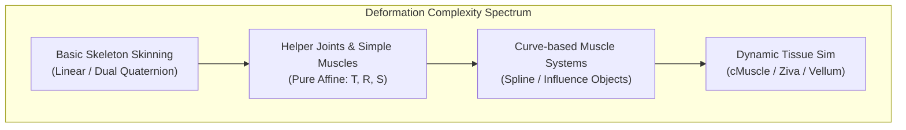
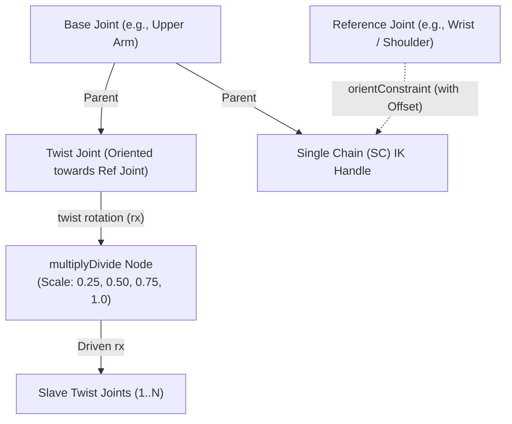
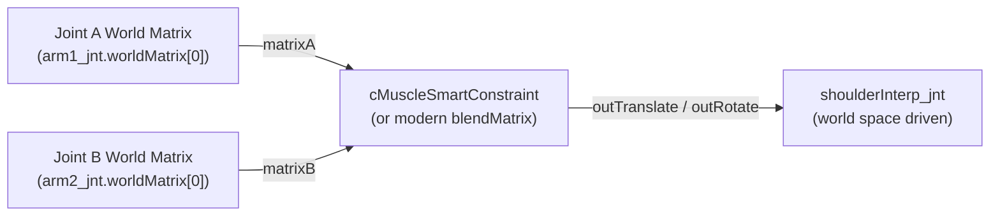
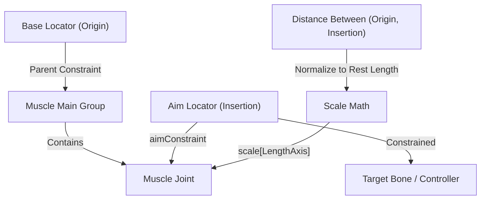

# Muscle Deformation Techniques: Helper Joints & Simple Muscles (Jakub Krompolc)

## Thai Executive Summary
สรุปสถาปัตยกรรมและกระบวนการสร้าง **Helper Joints (Simple Muscles)** โดย **Jakub Krompolc (Creature TD)** ซึ่งเป็นเทคนิคการจัดวางข้อต่อกระดูกเสริม (Auxiliary / Secondary Joints) เพื่อจำลองพฤติกรรมการเคลื่อนไหวและการเปลี่ยนรูปทรงของเนื้อเยื่อ (Flesh Deformation) รอบข้อต่อกระดูกหลัก ทำหน้าที่เป็นสะพานเชื่อมระหว่างการ Skinning กระดูกธรรมดา (Basic Skeleton Skinning) และระบบจำลองกล้ามเนื้อขั้นสูง (Curve-based Muscle Systems / Muscle Influence Objects)

**จุดเด่นและหลักการทำงานสำคัญ:**
1. **Pure Affine Transformation**: ระบบ Helper Joints ทั้งหมดใช้เฉพาะการแปลงพิกัดพื้นฐาน (Translation, Rotation, Scale) ส่งผลให้โครงสร้างเบา ประมวลผลแบบ Real-time ได้เร็วมาก เหมาะกับ Animation Rigs, ตัวละครระดับ Mid-ground/Background และส่งออกเข้า Game Engine (Unity, Unreal Engine) ได้ 100% โดยไม่ต้องพึ่ง Deformer ภายนอก
2. **3 ระบบ Helper Joints หลัก**:
   - **Twist Joints**: แก้ปัญหาเนื้อบิดลีบ (Volume Loss / Candy-Wrapper Effect) บริเวณต้นแขน ปลายแขน ขา และคอ โดยใช้ Single Chain (SC) IK Handle ร่วมกับ Orient Constraint และกระจายองศาบิดตามสัดส่วน (เช่น 100%, 75%, 50%, 25%) ผ่านโหนด Multiply
   - **Interpolate Joints (Half Joints)**: กระดูกชดเชยการหมุนกึ่งกลางข้อต่อ (เช่น ข้อศอก หัวเข่า นิ้วมือ ไหล่) หากมี 1 แกนอิสระจะหารค่ามุมหมุนด้วย 2 (`multDoubleLinear` * 0.5) หากมีหลายแกนอิสระจะใช้การผสมเมทริกซ์ (Matrix Blending) ผ่าน `cMuscleSmartConstraint` หรือโหนดเมทริกซ์
   - **Simple Muscles (Aim + Length Scale)**: เลียนแบบกล้ามเนื้อมัดจริง (Trapezius, Pectoral, Deltoid, Latissimus dorsi) โดยใช้กระดูกยึดระหว่างจุดเกาะต้น (Origin) และจุดเกาะปลาย (Insertion) ขับเคลื่อนด้วย `aimConstraint` ผสานกับการสเกลตามแกนความยาว (Length Axis Scale) เมื่อกล้ามเนื้อหดตัว กระดูกจะสเกลสั้นลง ป้องกันไม่ให้จุด Vertex แทรกตัวทะลุชนกัน (Penetration)
3. **หลักการ Weight Painting**: การเพ้นท์น้ำหนักสำหรับ Helper Joints ต้องทำแบบนุ่มนวล (Subtle Additive Weighting) ในท่าโพสที่ต้องการ ไม่ควรลงค่าน้ำหนักเต็ม 1.0 หรือกินบริเวณกว้างเกินไป เพราะจะทำให้รูปทรงบวมผิดรูป

---

## 1. Core Architecture & Philosophy

### Key Advantages of Helper Joints
- **Affine Transformation Integrity**: Relies strictly on standard joint `Translate`, `Rotate`, and `Scale`. No proprietary solvers, vertex-level deformers, or heavy CPU caches are required.
- **Production Efficiency**: Real-time evaluation inside Maya viewport without slowing down animator playback frames per second (FPS).
- **Pipeline Agnostic**: Bakes cleanly into FBX / GLTF for game engines, crowd simulations, and background creature assets where full dynamic muscle simulation is cost-prohibitive.

### Companion Maya Reference Scenes
- `helpJnt_simple_skeleton_skin.ma`: Baseline biped arm skinning before helper joints.
- `helpJnt_twist_setup.ma`: Single Chain IK twist extraction rig.
- `helpJnt_interp_setup.ma`: Matrix blending rotation interpolator.
- `helpJnt_simpleMus_setup.ma`: Aim-constrained, length-scaled muscle setup.

---

## 2. Technique 1: Twist Joints (Volume Preservation)

Twist joints prevent the notorious "candy-wrapper" twisting artifact along limbs and necks under axial rotation.

### Construction Pipeline
1. **Identify Base & Reference Joints**: For an arm twist, the upper arm joint is the **Base Joint**, while the wrist or shoulder is the **Reference Joint**.
2. **Twist Joint Creation**:
   - Create a joint with the exact orientation of the Base Joint, aiming directly towards the Reference Joint.
   - For wrist setups, aim along the bone axis; for shoulder setups, aim towards the shoulder (opposite to the arm bone).
   - Parent the Twist Joint under the Base Joint.
3. **IK Handle Isolation**:
   - Create a Single Chain (SC) IK handle from the Twist Joint.
   - Parent the IK handle under the Base Joint.
   - Apply an `orientConstraint` (maintain offset enabled) from the Reference Joint to the IK handle.
4. **Multi-Twist Falloff Chain**:
   - Create a chain of 3 to 6 secondary twist joints parented under the Base Joint.
   - Connect the twist axis rotation from the driving Twist Joint through a `multiplyDivide` node to distribute the twist percentage:
     $$\text{Twist Factor} \in [0.25, 0.50, 0.75, 1.0]$$
5. **T-Pose Calibration Rule**:
   - For upper arm setups, always align the arm in a raised **T-Pose** during rigging. This minimizes the initial rotational delta relative to the reference joint, preventing gimbal flips when the arm moves forward.

---

## 3. Technique 2: Interpolate Joints (Half Joints & Matrix Blending)

Interpolate joints automatically bisect joint angles to maintain the volume of bending joints (elbows, knees, fingers, and shoulders).

### A. Single Degree of Freedom (1-DOF: Elbows, Fingers, Knees)
For hinges rotating primarily along one axis:
- Parent the interpolation joint under the same parent as the child joint.
- Route child local rotation through a `multDoubleLinear` node (or `multiplyDivide`) with a multiplication factor of `0.5`:
  $$\text{Interpolated Rotate} = \text{Child Rotate} \times 0.5$$
- The interpolation joint will maintain the midway bisector angle automatically.

### B. Multi Degrees of Freedom (Multi-DOF: Shoulders, Hips)
When joints rotate across multiple axes, simple scalar division causes gimbal skewing. World space matrix blending is required:

- **Maya Muscle `cMuscleSmartConstraint`**:
  - Connect `matrixA` $\leftarrow$ `JointA.worldMatrix[0]`
  - Connect `matrixB` $\leftarrow$ `JointB.worldMatrix[0]`
  - Connect `outTranslate` $\rightarrow$ `InterpolateJoint.translate`
  - Connect `outRotate` $\rightarrow$ `InterpolateJoint.rotate`
- **Modern Maya 2022+ Equivalent**: Use the native `blendMatrix` or `wtAddMatrix` node connected to `decomposeMatrix` for zero-plugin dependency.

---

## 4. Technique 3: Simple Muscles (Aim + Dynamic Length Scale)

Simple muscles mimic physical muscle bellies between anatomical origin and insertion points.

### Mechanical Structure
1. **Hierarchy Grouping**:
   - `Muscle_GRP` $\rightarrow$ contains `Muscle_JNT`
   - Three reference locators: `Base_LOC` (Origin), `Aim_LOC` (Insertion), and `Up_LOC` (Twist alignment).
2. **Constraints**:
   - `Muscle_GRP` is `parentConstrained` to the base joint to receive local twist.
   - `Muscle_JNT` is constrained via `aimConstraint` to the `Aim_LOC`.
3. **Dynamic Primary Scale**:
   - As the limb articulates, the distance between origin and insertion shortens or elongates.
   - Connect the measured distance to the joint's primary length axis scale.
   - **Contracting (Short distance)**: Scale decreases along length; mesh vertices compress instead of piercing inside adjacent geometry.
   - **Stretching (Long distance)**: Scale increases; points stretch outwards, preventing mesh tearing.

### Anatomical Muscle Placement Guide

| Muscle Name | Origin / Base Anchor | Insertion / Aim Anchor | Scale Behavior |
| :--- | :--- | :--- | :--- |
| **Trapezius (Neck)** | Cervical vertebrae / Spine | Clavicle / Scapula spine | Dynamic length scale |
| **Pectoralis Major (Lower)** | Sternum / Ribcage | Humerus (Bicipital groove) | Dynamic length scale (contracts on adduction) |
| **Deltoid (Middle)** | Acromion / Clavicle | Deltoid tuberosity of humerus | Dynamic length scale (contracts on abduction) |
| **Latissimus Dorsi (Upper)** | Thoracic spine / Back | Intertubercular groove of humerus | Dynamic length scale |
| **Scapula Bone Guide** | Ribcage surface guide | Scapula bone tip | **Fixed scale = 1.0** (Rigid bone motion) |

---

## 5. Skin Weighting Best Practices for Helper Joints

1. **Subtle Additive Influence**:
   - Paint helper joint weights in the target contracted/flexed pose.
   - Keep weights low and blended; helper joints are meant to provide soft volume offsets, not dominate primary skeletal binding.
2. **Avoid Full 1.0 Clamping**:
   - Giving 100% influence over a large area to a single simple muscle joint causes severe pinching and ballooning artifacts.
3. **Incremental Implementation**:
   - Start with 1 or 2 helper joints per major region (e.g., biceps bulge or pectoral flex).
   - Test full range of motion (ROM) before adding secondary stabilizers.

---

## Cross-References & Related Rigging Systems
- **Corrective Joint Math**: [[wiki/autodesk_maya/matteo_szwatek_rigging]] — Vector Dot Product mid-plane sliding joints.
- **Matrix Aim Constraints**: [[wiki/autodesk_maya/matrix_aim_constraint]] — Node-based zero-pop matrix aim mechanics.
- **Real-time Surface Collisions**: [[wiki/autodesk_maya/matrix_mesh_collision_system]] — Real-time sliding matrix systems over skinned geometry.
